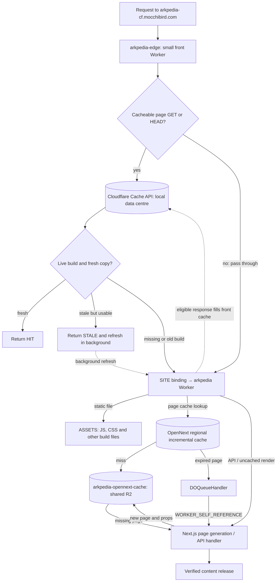
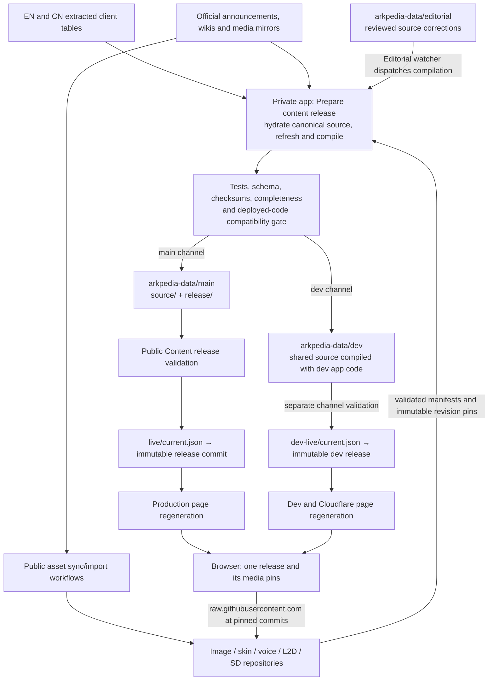
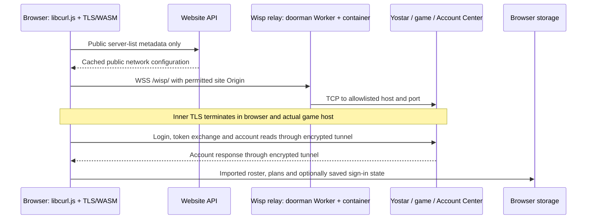
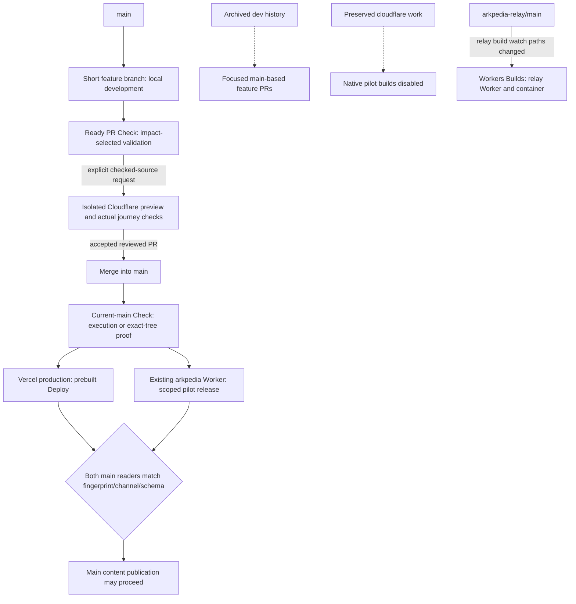
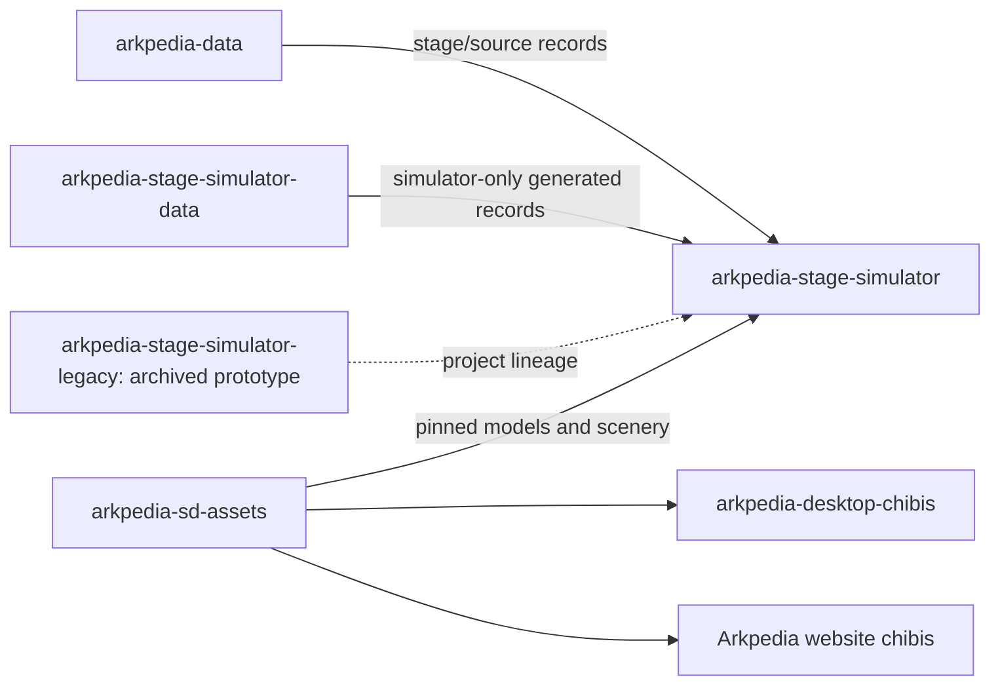

# How Arkpedia works

Architecture reference, updated 2026-10-25. Arrows show the direction of a request,
read, publication or deployment; responses return along the same connection.
The diagrams distinguish the production Vercel site from the Cloudflare migration.

## 1. Whole system

```mermaid
flowchart TB
  reader[Reader's browser]
  local[(Browser storage: account, plans, preferences)]
  reader <--> local

  subgraph web[Website delivery]
    prod["Vercel production · main<br/>www.arkpedia.net"]
    dev["Vercel development · dev<br/>arkpedia-dev.vercel.app"]
    edge["arkpedia-edge · front cache<br/>arkpedia-cf.mocchibird.com"]
    site["arkpedia · site Worker<br/>Next.js through OpenNext"]
    cache[(Regional page cache + R2)]
    queue[Durable Object revalidation queue]
    stage["arkpedia-staging<br/>Explicit feature candidate"]
    stageCache[(Separate staging R2 cache)]
    stageQueue[Separate staging revalidation queue]
    edge -->|SITE binding: miss, refresh or bypass| site
    site <--> cache
    site --> queue
    queue -->|background regeneration| site
    stage <--> stageCache
    stage --> stageQueue
    stageQueue --> stage
  end
  reader --> prod
  reader --> dev
  reader --> edge
  reader --> stage

  pilotDb[("D1: arkpedia-accounts-dev<br/>Identity, sessions and validated cloud saves")]
  providers[Google / Discord]
  site <--> pilotDb
  reader <-->|Arkpedia sign-in redirect| providers
  site <-->|OAuth identity exchange| providers

  subgraph content[Public content and media]
    data["arkpedia-data<br/>source records + generated releases"]
    assets["Public asset repositories<br/>images, skins, voices, L2D, SD"]
  end
  prod -->|live pointer and verified release| data
  dev -->|dev-live pointer and verified release| data
  site -->|live pointer and verified release| data
  stage -->|checked candidate channel; main-based previews use live| data
  reader -->|commit-pinned media URLs| assets

  subgraph imports[Account import: encrypted tunnel]
    door["arkpedia-relay Worker<br/>origin and rate gate"]
    container[Relay container: Wisp TCP forwarding]
    game[Yostar login, game and Account Center servers]
    door --> container
    container --> game
  end
  reader -->|WSS| door

  upstream[Game tables, official announcements, art mirrors, wikis]
  jobs[GitHub Actions: import, validate, compile and publish]
  upstream --> jobs
  jobs --> data
  jobs --> assets
  app["Private arkpedia repository<br/>pages, components, logic and workflows"]
  app -->|Check then prebuilt Deploy| prod
  app -->|Check then prebuilt Deploy| dev
  app -->|successful main Check: scoped pilot release| site
  app -.->|separate existing front Worker publication| edge
  reader -->|direct audio or embedded player| music[Monster Siren CDN / YouTube]
```

The browser runs the interactive planners, games and account-import client.
The website renders pages and supplies public API responses. Game content and
media can change independently of application deployments.

## 2. Cloudflare request and cache path

- **Front cache:** caches suitable 200 page HTML and `/_next/data/...` responses.
  Freshness follows the site's cache headers; stale retention is capped at one day.
  Build-manifest checks prevent cached HTML referencing removed deployment files.
- **Bypass:** `/api/*`, `/account`, static files, image optimization, non-GET/HEAD
  methods, authenticated/range/upgrade requests and preview-mode cookies. Responses
  with cookies, private/no-store/no-cache directives or an unknown build are not kept.
- **Regional incremental cache:** a separate layer inside the site Worker. It keeps
  a local copy for at least one day and refreshes from R2 in the background on hits;
  page freshness and regeneration still follow ISR rules.
- **R2:** shared generated-page/data cache; also holds cached signed Monster Siren
  audio addresses. It is not the canonical game dataset or a user-account database.
- **Durable Object:** coordinates background revalidation. The configured
  `new_sqlite_classes` migration creates Durable Object storage; it is not a D1 binding.
- **Vercel:** provides its own page/CDN/ISR delivery instead of this Worker chain.
  `arkpedia-edge` does not front the Vercel production site.

## 3. Data and asset publication

`source/` is canonical; `release/` is compiled delivery output. The app repository's
bundled `data/` is a fallback/development snapshot. The loader verifies the pointer,
manifest and page hashes and retains the last valid release on a failed refresh.
Most content pages revalidate after 60 or 300 seconds; pointer polling, GitHub
caching and request-driven regeneration also affect visibility. An already-open
page retains its release to avoid mixing records and media versions.

Static art comes from `arkpedia-image-assets` and `arkpedia-skin-assets`; voice clips
come from the five `arkpedia-voice-*` repositories. `arkpedia-l2d-assets` supplies
animated outfit models, textures and effects; `arkpedia-sd-assets` supplies chibi
models and scenery. `arkpedia-color-palette` supplies community corrections applied
when the palette catalogue is built. L2D/SD catalogues also carry their own pinned
model references; do not assume every media type uses the same manifest schema.

The normal media path is direct GitHub raw delivery. Compatible root-relative image
paths redirect to pinned assets. Image optimization, when invoked, is a separate
site route; it is not the bulk media publication pipeline.

## 4. Account import and privacy boundary

The relay can observe connection metadata and forwards encrypted bytes. It does not
terminate the inner game-server TLS or read the email, login code, game tokens or
account response. The doorman Worker terminates the outer WSS connection.
Origins, destinations, ports and connection limits constrain relay access.

The relay is `arkpedia-relay.cloudflare-1ff.workers.dev/wisp/` (`config/relay.json`).
Preview uses `preview-relay.arkpedia.net/wisp/`, a custom hostname on that same Worker.
The VPS relay at `relay.arkpedia.net` was retired on 2026-10-28. A
container is needed for the game hosts that the plain Worker's TCP API cannot reach.

Storage belongs to the browser origin: www, dev and Cloudflare do not automatically
share imported accounts or plans. Public network metadata caching is separate from
authenticated account traffic. The game-import tunnel and Arkpedia sign-in are
different systems: Google/Discord sign-in does not pass through the game relay.

### Arkpedia account pilot and staging

The Cloudflare pilot now binds the EU D1 database `arkpedia-accounts-dev` to the
`arkpedia` Worker. Better Auth handles Google/Discord identity and sessions under
`/api/auth/*`; `/api/cloud-account` validates and stores supported personal data.
These endpoints return private/no-store responses and bypass the front page cache.
R2 remains a rendered-page/audio cache; it is not the account database.

Cloud saves use a closed list of supported stores and preferences. Imported game
records require explicit permission, and saved Yostar sign-in credentials are
excluded. Owner checks and revision comparisons prevent one user's writes from
replacing another user's save or silently overwriting a newer revision. Restoring
data updates the current document while retaining its music engine. See
[account implementation and acceptance](development/cloud-accounts.md).

The www/dev deployments remain browser-only. The separate staging Worker includes
the account code but has no D1 or OAuth bindings: its account APIs return 503,
sign-in controls are unavailable, and browser-local import/export continues to work.
The deployed pilot's anonymous API privacy and OAuth starts have been verified;
the maintainer's complete provider login, explicit provider linking and save roundtrip
remain acceptance work. A production account database and public-origin settings
must be chosen before promoting that feature or moving the public domain.

## 5. Code release and preserved legacy branches

Application and content releases are separate. Supported records/media can ship
through data publication; changed UI, calculations, mechanics or incompatible
schemas require an app release. Docs-only changes skip app Check/Deploy. Dev synchronization and deployment are retired; unreleased work is retained in
archive tags for individual extraction. See the retirement record in
[branch-sync.md](development/branch-sync.md). Cloudflare branch preservation and
public-domain cutover remain separate.

## 6. Related projects

These are related applications and data consumers, not a dependency through which
all website requests pass. The desktop companion is a separate app with its own
settings. Its README explicitly separates it from website account import/storage.
This diagram records repository relationships, not an asserted live simulator
hosting endpoint. The organization `.github` repository owns profile/community files.

## Source map and verification limits

The first checked-main pilot release is main8ee3f3dc/version56bdbefb, with the same
clean live/schema2 fingerprint as www. Native pilot builds were disabled and drained;
the release owner preserves existing D1/cache/queue/self bindings and auth secrets.
Actual public/browser/account/provider/archive/sync checks passed. Previously unloaded
old-client navigation upgraded/reloaded the document; seamless continuity is not claimed.
The existing analytics hostname is nowarkpedia-cf.mocchibird.com with post-change
actual beacon ingestion verified. Isolated staging remains separate and unbound to
accounts; automatic preview retirement40208662442 passed. Front edge/relay
installation and DNS were not changed by this release. Base edge routing came from
8520b03a and relay source/config fromf2e2c3fb; no fresh VPS installation audit is implied.
Draft PR777 prepares optional public R2 delivery inside the existing edge Worker,
but no remote bucket/binding/pointer is active. Final cost/soak, old-client retention,
rollback rehearsal and public-domain cutover remain open; see the dated progress log.

| Area | Authoritative references |
| --- | --- |
| App routes and feature ownership | [Repository map](repository-map.md), `pages/`, `lib/` |
| Edge routing and bypass rules | [Edge Worker README](https://github.com/arkpedia/arkpedia/blob/8520b03abe6175e7069c7c06b881faa492cc22b2/workers/edge/README.md), adjacent `wrangler.jsonc` and `edge.mjs` |
| Site Worker, R2 and queue | [Production release and recovery](development/production-release.md), main root `wrangler.jsonc`, `open-next.config.ts`, `lib/cloudflare/regionalPageCache.ts` |
| Data release and recovery | [Runtime content](development/runtime-content.md), [pipelines](development/data-pipelines.md), `lib/content/server.ts`, `config/content-channels.json` |
| Asset URLs and pins | `config/asset-delivery.json`, `data/assets/revisions.json`, [data sources](development/data-sources.md), asset repository manifests |
| Account transport | `lib/account-import/relay.ts`, branch-specific `config/relay.json`, [relay repository](https://github.com/arkpedia/arkpedia-relay) |
| Arkpedia account pilot | `lib/cloud-account/`, `pages/api/auth/`, `pages/api/cloud-account.ts`, `migrations/accounts/`, [setup and acceptance](development/cloud-accounts.md) |
| Isolated feature staging | `wrangler.staging.jsonc`, `open-next.staging.config.ts`, [verified staging guide](development/cloudflare-staging.md) |
| Release orchestration | [Branch sync](development/branch-sync.md), [automation](development/automation.md), `.github/workflows/` |
| Separate applications | Organization simulator, simulator-data, desktop-chibis and SD asset repository READMEs |

Update this reference when changing domains, content channels, Worker names/bindings,
cache responsibilities, relay selection, storage ownership or repository consumers.
