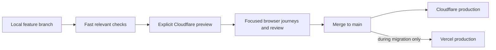
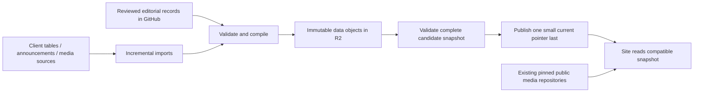

# Arkpedia system simplification plan

Planning date: 2026-10-24. This is the target and migration backlog, not a claim that
the current deployment already works this way. Read alongside [current architecture](../architecture.md).

## Decisions agreed with the maintainer

- One application codebase on `main`, with short-lived feature branches and Cloudflare
  feature previews. No permanent `dev` or `cloudflare` mirror is needed in the end state.
- Develop and iterate locally. Publish a preview when a feature is ready to test remotely.
  Merge reviewed, verified features into main to release. "Dev" means an environment,
  not another permanent integration branch.
- Keep Vercel serving www until Cloudflare production is verified. Switch the public
  domain only after the migration acceptance checks and rollback rehearsal pass.
- Routine validated data updates publish automatically; risky changes get a preview.
- Review unreleased dev features individually. Do not promote all of dev just to
  consolidate infrastructure. Review the framework/adapter upgrade as a distinct change.
- Preserve the old simulator and its branches in an archived
  `arkpedia-stage-simulator-legacy`, then rename the standalone project to
  `arkpedia-stage-simulator`. No repository deletion is needed.

## Findings and constraints

- Main and dev differ in 254 files; dev and cloudflare differ in another 47 files
  at the initial audit. "Zero behind" describes ancestry, not equal code.
- One measured successful Check took about 27m35s. Its browser suite took 18m02s,
  application/Python tests 1m58s, and the two Next builds together 2m27s. This is one
  sample, not a p50 benchmark. [Run evidence](https://github.com/arkpedia/arkpedia/actions/runs/40079637318).
- Current Check already reuses successful exact-tree evidence after merges and has
  browser-impact detection. Extend those mechanisms rather than adding a competing planner.
- The old simulator has multiple feature branches. One sampled branch,
  `feat/tragodia-public`, is one commit ahead and 265 behind master. Archive only after
  recording every branch and unique commit, including work not present in the standalone.
- `cloudflare` and `cloudflare/dev` cannot coexist as Git branch refs. Feature branches
  remove the need for either name.
- Current R2 is OpenNext's generated-page cache, not canonical game data storage.
- The existing app content pipeline aggregates multiple sources already. The main
  simplification opportunity is delivery, compatibility and publication orchestration.
- Initial planning did not audit provider dashboards, billing, storage or traffic.
  Subsequent read-only R2 storage/operation and GitHub consumer inventories are recorded
  below; invoices and complete provider configuration remain open.

## Target release path

Use one build owner for Cloudflare: prefer the existing self-hosted CI build/deploy
path if the preview proof supports it; otherwise use Workers Builds for that build
and do not also build the same target in Actions. Compare measured cost and queue time
before choosing. Local iteration must not trigger remote builds by itself.

A preview is a real isolated environment, not merely an uploaded production Worker
version URL. Promotion must identify the tested app commit, build configuration and
content contract. Reuse a build artifact only if environment-specific inlining and
bindings allow it; never label a separately rebuilt bundle as the exact tested artifact.

## CI target: less repeated work, relevant gates

| Change / moment | Default work |
| --- | --- |
| Local iteration | Relevant unit tests and changed-area checks; normal dev server |
| Docs only | Documentation links/syntax; no app build or remote preview |
| Importer/data tooling | Importer/contract tests and relevant validation; no all-page browser crawl |
| Ordinary UI feature ready for preview | Typecheck/lint, relevant units, one target build, affected desktop/mobile journeys |
| Shared navigation, tokens, layout or storage | Broader journey coverage, themes and viewport checks |
| Content schema/runtime adapter/dependencies | Full compatibility and rollback checks plus production-like build |
| Main release | Reuse exact-tree proof where valid; deploy gate and short deployed smoke suite |
| Full regression | Manual and release-candidate runs; decide later whether a scheduled run adds value |

Keep a compact core suite: homepage navigation, schedule upcoming/past and Back,
story list/map navigation, operator detail, base planner and mocked account import.
Feature suites cover their own behavior. Real account imports are a separate human
acceptance check using the maintainer's account, never CI credentials.

Move exhaustive external-media verification to asset/data publication, with affected
media checks on app changes. Eliminate duplicate browser assertions and redundant
page visits after identifying what each test protects. Keep useful mechanics,
provenance, privacy, schema, publication-integrity and rollback tests.

Unknown file impact falls back to broader checks. Show selected/skipped suites and
why. Do not make a fast lane green by skipping a failed gate or widening tolerances.
Initial engineering target: ordinary ready-for-preview feedback below 8 minutes on
current hardware; report baseline and p50/p95 before treating this as a promise.

## Data and assets: recommended pilot

GitHub retains reviewed source, provenance, import tooling and history. R2 initially
holds generated delivery data only, separate from the existing ISR cache. Media stays
where it is during the pilot. Migrate a media family only after measuring bytes,
object counts, read/write traffic, cache hit rates and rollback/storage costs.

Keep versioning automatic and mostly invisible: one snapshot identity, a manifest,
and immutable objects with asset references. Upload and verify every required object
before moving the small environment pointer. Readers pin one snapshot per page/session.
Serialize publishers and reject stale updates; R2 is not a multi-object transaction.
Retain a tested previous snapshot and publish rollback by moving the pointer back.

Prefer reuse of unchanged objects to copying the entire asset/data corpus per release.
Use a readable release report and one publish/rollback command; maintainers should not
manually coordinate Git SHAs, multiple branches and deployment fingerprints.

Start with an R2 mirror of the existing schema/payload shape to separate delivery
migration from a data-model rewrite. Later, evaluate compiling normalized game records
into page props in the app instead of publishing app-specific props. Keep that change
only if measured bundle size, render CPU and compatibility are acceptable. Replacing
every payload with one giant JSON download is not the target.

Routine previews read the current production snapshot without write access. A risky
import/schema change uses its own candidate snapshot; it must not update production's
pointer. Preview page caches, revalidation queues and any writable resources are isolated.
Keep original/upstream provenance and explicit editorial overrides so later imports do
not erase corrections. A missing input preserves the previous good record and reports
the missing piece rather than silently overwriting it.

Risky changes include schema migrations, bulk removals, identity/ID remapping, changed
source precedence and unusually large diffs. Preview the proposed additions/changes/
removals and checks. Routine updates with stable schema and expected diffs publish
automatically after validation. Thresholds will be based on actual dataset changes.

Keep GitHub delivery as a measured, explicit fallback during the pilot. Do not leave
two independently writable sources of truth. Garbage collection must preserve every
snapshot referenced by a retained deployment, preview or rollback; retention and
object reachability must be specified before deletion is enabled.

R2 Standard currently includes 10 GB-month storage, 1M Class A and 10M Class B
operations monthly, with no egress charge. It is not unlimited free storage. Use a
custom domain for cached public production delivery, not the rate-limited r2.dev
endpoint. A private Worker binding is appropriate for server-only reads.
[Pricing](https://developers.cloudflare.com/r2/pricing/),
[public delivery](https://developers.cloudflare.com/r2/buckets/public-buckets/).

## Ordered milestones and acceptance

Reviewed 2026-10-25, 11:20 UTC. **30 of 52 acceptance items are complete and checked.**
The items differ substantially in size; this is not a percentage of time remaining.
Completed controller implementation and real lifecycle proof are now separate from
the remaining CI credential/activation gate. Exact evidence and limitations are in
the [progress log](system-simplification-progress.md).

| Milestone | Checked | Current state | Main remaining gate |
| --- | --- | --- | --- |
| 0. Preserve and measure | 4/6 | Source inventory and backups complete | Provider dashboards and actual usage/bills |
| 1. Cloudflare development loop | 9/9 | Automatic checked-artifact publication and owned-close retirement verified | Maintain these checks on subsequent previews |
| 2. Proportional CI | 8/9 | Main/CF prerequisites released; selected/reuse proof verified | Representative timing/reliability measurements |
| 3. One codebase | 3/8 | Framework, hosting foundation and reviewed account port released | Reviewed integration, unified production target, branch retirement |
| 4. R2 delivery | 3/7 | Actual local app/two-snapshot proof; inactive foundation PR771 | Current CI, isolated remote/cost and activation proof |
| 5. Production cutover | 0/6 | Preliminary checks recorded | Complete parity, old-tab, rollback and measured soak |
| 6. Simulator naming | 3/7 | Branches/unique work preserved; source links audited | External consumers, rename/archive and reference verification |

Latest verified main release is PR773 at616f4cbf, after the R2 foundation PR771
and explicit preview notifier PR772. Check40188150120 and Deploy40188174941 passed.
Actual www clean production identity, four desktop/mobile dark/light account
journeys and release-status production health passed. The unavailable cloud-account
section is removed; local import/export remains available. Configured accounts
remain enabled only on the existing migration pilot; no D1/OAuth/DNS configuration
changed. Full R2-foundation public acceptance remains recorded in the progress log.

PR773 also completed the real automatic preview cycle: producer40187663125,
publication40187870567 and owned-close retirement40188151181. Independent provider
inspection verified baseline591c/19b and unchanged pilot066ea33d. The repeatable
Cloudflare development-loop milestone is now9/9. R2 app code is merged but remote
R2 publication, measured comparison and retention/activation remain open.

### 0. Preserve and measure

- [x] Record agreed branch/data/simulator direction and initial CI timing evidence.
- [x] Inventory unreleased feature differences and source consumers across all 18
  organization repositories: 2,486 source/configuration/document files plus simulator
  tracked-text review. Preserve the 225-file deferred-feature inventory for individual review.
- [x] Preserve app branch/tag history and verified complete-history bundle; mirror and
  verify bundles/refs for both simulators. Record known clean app and two data-snapshot
  rollback candidates in the progress evidence. This records targets, not a completed
  production-domain rollback rehearsal.
- [ ] Complete provider-dashboard deploy hooks, external incoming links and resource/
  cron inventory; source inspection alone cannot prove external configuration.
  GitHub API confirms no repository webhooks on the app, data and both simulators;
  both simulators also have no GitHub Pages or deployment records, and the account
  has no Cloudflare Pages projects. Workers/Vercel integrations and incoming consumers
  still need independent verification.
- [x] Read current R2 bucket/storage and calendar-month operation metrics through the
  provider API. Preserve raw account telemetry in local cache evidence; sampled
  stored bytes are not billed GB-months and calendar month need not match invoice cycle.
- [ ] Complete actual traffic, CPU, build-minute and invoice comparison. Initial CI
  timings and data sizes are recorded. Cloudflare and Vercel billing/dashboard
  baselines have now been inspected and retained privately; different billing periods
  and pilot-versus-production traffic still prevent a production-scale cost comparison.

### 1. Prove the Cloudflare development loop

- [x] Test one harmless feature preview using the actual OpenNext adapter and pinned
  Wrangler, including static files, ISR, revalidation and release refresh.
- [x] Verify WORKER_SELF_REFERENCE never calls production from staging; use a separate
  staging Worker because current native Preview service bindings can target production.
- [x] Verify separate writable R2/cache resources, queue and Durable Object namespace.
- [x] Test exact staging account-relay origin and network metadata rules, including
  allowed TLS destinations and rejected private/foreign destinations and origins.
- [x] Reuse the existing relay path; do not create a container per ordinary UI preview.
  Unintended non-production relay builds are disabled.
- [x] Choose a separate staging Worker/environment from feature branches as the proven
  initial approach. A permanent development branch is not required by this design.
- [x] Create and update staging from clean Linux artifacts without changing production
  bindings/routes; verify isolated self-calls, noindex and unavailable cloud accounts.
- [x] Implement and prove the repeatable preview controller's creation/update,
  ownership, serialization, retirement and failure recovery. #768 is merged as
  5010762b. Actual local-OAuth deployments passed publish/update, 20 browser cases,
  stale-close protection, retirement and controlled recovery to the original
  baseline. Source/config/artifact identity checks and non-cancelling shared workflow
  serialization are implemented. This completes controller implementation and its
  real provider lifecycle proof; it does not activate CI publication.
- [x] Complete actual automatic callback/owned-close acceptance after successful
  trusted-main/scoped-credential checks. PR772 released the explicit API-only
  completion notifier. PR773 source03d6b03a passed Check40186842441; one request
  40187638673 built its native artifact in40187663125. Automatic completion
  publication40187870567 deployed that exact source/fingerprint. Four actual
  desktop/mobile, dark/light account journeys passed. After merge616f4cbf,
  automatic owned-close40188151181 retired it. Independent provider inspection
  at11:19:42 UTC confirmed baseline591c/19b and unchanged pilot066ea33d.
  No manual recovery or expanded credential was needed for this cycle.

[Preview behavior](https://developers.cloudflare.com/workers/previews/),
[resource/service isolation limitations](https://developers.cloudflare.com/workers/previews/resources/),
[OpenNext local preview](https://developers.cloudflare.com/workers/framework-guides/web-apps/opennext/).
The existing local `cf:preview` command is not the remote feature-preview workflow.

### 2. Make CI proportional

- [x] Record baseline suite timings and protected behavior; identify relevant core,
  feature and affected layout-census journeys while retaining shared/unknown fallback.
- [x] Implement and run quick draft checks without a website build/browser run or
  reusable proof. Frozen policy-head quick Check 40142927680 passed; later browser-only
  fixture repairs are undergoing the required full validation.
- [x] Implement cumulative impact selection, full fallback and actual execution-ledger
  validation, retaining exact-tree reuse/resource limits and account-integrity checks.
  The policy has 119 passing focused cases; a real bundled selected run has
  32 passes/eight intentional skips across 40 identities in 27.4 seconds.
- [x] Verify existing automatic-integration exact-tree reuse with real Git fixtures
  and Actions smoke; recover and revalidate main's actual full-browser evidence after
  its merged PR branch is deleted. Draft/partial evidence cannot become a full baseline.
- [x] Implement one locked Vercel install plus exact built/public clean-identity gates,
  replacing the duplicate install that dirtied production's lockfile. Local tests pass.
- [x] Pass and merge the final full Linux first-policy validation for #756, and deploy
  a publicly verified clean main identity. Full Check 40148916171 passed at ddc6e89a:
  1,462 passes/217 intentional skips, all 1,679 identities validated and artifact
  12582735814 recorded. Merge 6b5ff403 has the exact same tree; main Check
  40151346338 reused that proof. Deploy 40151435570 passed both built/public identity
  gates. Actual www reports clean 6b5ff403/live/schema2 with the independently
  expected fingerprint; release status is healthy and all 36 deployed route/theme/
  viewport cases pass. The earlier dirty main74 deployment is superseded.
- [x] Complete the coordinated Cloudflare #761 policy adoption and deployed verification.
  Full Check 40147078074 passed with 1,502 passes/217 intentional skips. #761 merged
  as 6ed9cfa4; the push reused verified full-tree evidence. Native Worker build
  fb36b36c-479c-4f1e-968b-6f6ad6981a75 succeeded and the exact clean revision is live.
  The accounts owner verified OAuth starts/private APIs, provider images across
  eight theme/viewport states, and a healthy release report. This is the CF pilot,
  not unified main production or the public-domain cutover.
- [x] Prove an actual narrow PR's selected lane and partial artifact reuse in Actions.
  Genuine tooltip-only CF #764 at c4e8d2d passed Check 40154214389: 248 selected/
  1,471 omitted of 1,719, with 225 passes/23 intentional skips in 1.9 minutes.
  Validated partial artifact 12583703976 names the exact tree/current policy and
  full baseline 40151562631; no full marker was uploaded. Merge de829d1e reused
  that partial proof in push Check 40155507469; the heavy check was skipped.
  Workers Build 8568743d-4f88-4440-bf7b-937b0c764497 deployed that exact clean source;
  the actual serving Worker version is 066ea33d-f48e-4fd3-b4dd-278957420bb4.
  The owner verified the live hint, provider icons, autosync privacy and OAuth starts.
  Main's equivalent prerequisite #767 then passed full Check 40157028703:
  1,462 passes/217 intentional skips, all 1,679 identities validated, 17.2 minutes
  of browsers. Merge f9a7bcb3 retained exact tree f33eb864; push 40159151439 reused
  artifact 12584763953. Deploy 40159295667 succeeded; actual www identity/fingerprint,
  healthy main release report and all 36 public browser cases passed. The earlier
  eight mobile failures remain a recorded observation with cause unproven; no
  assertion, timeout or retry was loosened to make the later run pass.
- [ ] Measure several real PRs and queue/build/browser times; remove further duplicate
  crawls/builds only when their protected behavior is retained. No p50/p95 or below-eight-
  minute ready-PR claim is established by the local probe or quick draft alone.

### 3. Consolidate code and branches

- [x] Review and release the framework upgrade independently of unreleased dev features
  (#742), preserving dev work (#743). Verify the locale (#747) and audio/native-inert
  corrections (#752) on actual www.
- [x] Review the main-based Cloudflare hosting adaptation independently (#755), merge
  it into main and prove its isolated staging role/cache/self-calls without D1/OAuth.
  Clean Vercel release identity repair remains the separate CI/deployment gate above.
- [x] Preserve deferred dev features on annotated migration tags and a verified bundle.
  The [net-difference inventory](deferred-feature-review.md) separates route migration,
  optimizer, techniques, preferences, diagnostics, music and CI work.
- [ ] Review and promote the remaining product features individually; preserve the
  accounts owner's D1/OAuth/consent/archive implementation and migration contracts.
- [ ] Finish reviewed branch reconciliation. #759 at d6026597 passed full Check
  40138347385. The #764 CI/deployed proof hold is now released; reconcile the
  current main/CF tips and revalidate the changed integration tree before merging.
- [ ] Make main deploy to Vercel and the CF production-candidate hostname from the same
  reviewed code. Verify account/provider differences and content compatibility explicitly.
- [ ] Switch feature PRs/previews to main. Stop Vercel dev deploys and obsolete dev
  content compiles only once all consumers are moved or accounted for.
- [ ] Retire main-to-dev/cloudflare synchronization and alerts after dependants move.
  Preserve final branch tips before deleting refs; update AGENTS/README, workflows,
  content-channel selection and release reporting together.

### 4. Pilot data delivery on R2

- [x] Mirror and verify two complete real snapshots in the local native S3/workerd
  harness: 8,963 paths, unchanged-object reuse, 207 new objects for the next snapshot,
  zero writes for an unchanged repeat. Retain the original manifest as the index.
- [x] Prove local checksum/completeness failures, concurrent/stale publication rejection,
  pointer-last promotion and one-pointer rollback without advancing corrupt candidates.
- [x] Implement explicit inspect/stage/promote CLI, pinned source loader, immutable
  reader/cache and compiled-source handoff at 75a0eeb2. All 36 focused cases pass;
  native browser transport covers both snapshots, warm-cache zero R2 reads, HEAD/304
  and held old/current URLs. Full handoff uses one manifest request/zero payload downloads.
- [ ] Integrate the reader with the actual app and prove isolated remote publication,
  CAS/cache/fallback/rollback using scoped credentials. No remote resource, route,
  binding, app setting or content pointer has enabled this pilot.
- [ ] Compare real latency, CPU, memory, cache hit rate and monthly operations/storage
  costs against GitHub delivery; define safe retention/reachability before cleanup.
  Include the existing build-scoped OpenNext ISR cache separately from immutable
  data objects, preserving active, rollback and old-tab references.
  A local two-release measurement on 2026-10-25 found 382,474,086 bytes in the
  retained union and 121,201,650 incremental bytes for 207 objects. All 206 changed
  page bodies changed only `videos`, yet repeated one unchanged 559,765-byte
  `__contentTables` block (115,311,590 serialized bytes across those pages).
  Evaluate a shared immutable table representation as a separately versioned
  compatibility change after the current delivery baseline is proven. Retain
  schema-2 readers/releases and verify old-tab hydration, checksum validation,
  fallback and rollback; these measurements do not authorize deleting old objects.
- [ ] Promote only if the app, compatibility, reliability and budget gates pass; retire
  duplicate compiled channels/pointers only after consumers move.
- [ ] Decide any media-storage migration family by family. Current provider logos are
  in the existing artwork repository; this is not an R2 media migration or bulk copy.

### 5. Cut production over, then retire Vercel

Preliminary desktop/mobile/theme, account-provider, media and Back checks are in the
progress log. They do not establish whole-site parity on a single production candidate.

- [ ] Complete representative routes, redirects, canonical/SEO, image variants, voices,
  music, animated art, imports, planners, Back and theme/viewport acceptance on the
  unified candidate, including the actual authenticated account journeys.
- [ ] Verify content-only updates, new pages, deploy invalidation, old tabs, schema
  compatibility, failure/rollback and cold/warm behavior. Current staging old tabs
  recover by reload after old chunk 404s; seamless continuity is not yet proven.
- [ ] Verify DNS, apex/www, certificates, headers, analytics and relay/OAuth origins.
  Preserve browser storage on canonical www; alternate-host storage does not transfer.
- [ ] Run a measured multi-day soak including app deployment and data publication.
- [ ] Rehearse and agree the public-domain rollback window; then move arkpedia.net/www
  to CF with Vercel available for rollback and recheck the actual public domain.
- [ ] Disable Vercel deployments only after public-domain checks and rollback-window
  gates pass; remove obsolete provider resources last.

### 6. Simplify simulator naming and close out

- [x] Capture and verify all legacy/standalone branches, tags, PR refs and unique work.
  Initial capture: legacy21 branches/20 with unique commits, standalone29/27.
  The 2026-10-25 refresh preserves standalone31/29 and its rewritten earlier tip.
  Refresh again immediately before rename; no deletion has occurred.
- [x] Audit pinned repository source consumers, workflows and raw/CDN references; repair
  the four invalid SD foundation pins through SD #59 while preserving exact source bytes.
- [x] Verify simulator GitHub repository identity, Pages and deployment metadata;
  both have no GitHub Pages or deployment records. Read-only Cloudflare Pages
  inventory is empty. This does not establish absence of Workers/Vercel Git apps.
- [ ] Confirm external/dashboard consumers and final incoming-link migration before
  reusing the legacy name. Source audit is complete; this external gate remains open.
- [ ] Rename the old repo to legacy and archive it, then rename standalone to the desired
  name, retaining licences, attribution, issues/releases and access to branch history.
- [ ] Update and verify all references. Reusing the old name can resolve old URLs to
  the new project; never rely on implicit redirects for old raw paths/commit pins.
- [ ] Reconcile final architecture/docs/scripts after migration and publish the measured
  cost/latency/CI comparison. Keep historical proof in the progress log.

## Boundaries and remaining choices

### Initial cost estimate

Measured the production release manifest on 2026-10-24: 8,963 logical delivery
files totalling 258,553,041 bytes (about 259 MB), including 838 page records.
The first snapshot deduplicates to 8,849 payloads/258,176,640 bytes, plus its
3,095,796-byte original manifest. The two-real-snapshot union is 9,055 payloads:
376,282,909 bytes plus 6,191,177 manifest bytes (about 382.5 MB before pointer and
R2 metadata). These figures were recomputed from the original hash-verified manifests. This excludes the image/voice/animation corpus, source records, current
OpenNext cache and request overhead. Thirty fully separate snapshots of this size
would use about 7.76 GB before those other objects; deduplication should reduce it,
but existing R2 usage consumes the same account allowances. One full daily upload
would write roughly 269,000 objects over 30 days; avoid repeating it per preview.

Initial planning allowance for additional preview/data-pilot usage: roughly USD
0–5/month if Workers Paid is already enabled, preview traffic is low, existing
allowances have headroom and relay containers are not duplicated. This is a
conditional estimate, not a verified billing forecast or spend cap. Workers Paid's
USD 5/month minimum would be additional if it is not already active. App CPU,
requests, Durable Objects, logs, build overages and relay-container activity still
need measurement. No separate container per UI preview is planned.

R2 and Workers/build pricing were checked against official documentation. Workers
Builds Paid includes 6,000 build minutes/month with USD 0.005/minute overage; using
existing self-hosted builds instead avoids that build-meter charge but still uses
NAS electricity, hardware and queue capacity. Removing Vercel only saves cash if
its current bill includes avoidable charges. Do not claim a net saving before
reading the current invoices and usage.

References: [Workers pricing](https://developers.cloudflare.com/workers/platform/pricing/),
[build pricing](https://developers.cloudflare.com/workers/ci-cd/builds/limits-and-pricing/),
[container pricing](https://developers.cloudflare.com/containers/platform/pricing/).

No DNS cutover, repository rename/archive, branch deletion, provider preview-model
switch, new billing commitment or R2 production publication has happened in planning.
These steps follow their evidence gates. The maintainer approved the legacy archive/
rename direction; execute it after the dependency/branch inventory, not as deletion.

Final choices still need the preview proof and measurements: native Previews versus
a staging Worker, CI build ownership, production content compatibility policy, R2
retention, cost budget and Vercel rollback window. Do not solve uncertainty by adding
another permanent branch, database, queue or service by default.

### Current execution checkpoint

Latest verified main release is #770 at9796b663 (exact tested tree482042e6).
Full Check40170783235 passed1500/217 browser cases; push40173692769 reused its
proof and Deploy40173713827 passed. Actual www clean identity, healthy main release
report,36 global browser cases and the accounts owner's34+4/API acceptance pass.
Accounts remain enabled only on the existing Cloudflare migration pilot; no
canonical D1/OAuth/DNS configuration changed.

Scoped CI publication40172881817 and retirement40173445887 passed for the single
trusted-main PR770 artifact, restoring the verified591c/19b baseline. Preview
handlers are enabled; PR773 subsequently proved the automatic callback/close lifecycle (runs40187870567/40188151181).
PR771 contains the inactive R2 app-reader foundation, with local native/app browser
proof and88 composed focused tests. Its corrected full Check40175573617 is running after a bounded declaration-lint fix.
Remote R2 publication, measured comparison and retention/activation remain open.

Both provider dashboard/billing baselines are recorded privately. Different billing
periods and pilot-versus-production traffic prevent a measured net-savings claim.
Standalone simulator preservation was refreshed to31 branches/29 with unique work,
with a new verified bundle retaining the earlier force-updated tip as well. External
incoming consumers and ordered rename/reference migration remain open. No branch
deletion, repository rename/archive, DNS cutover or Vercel retirement has occurred.
