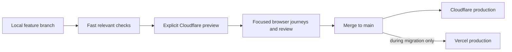
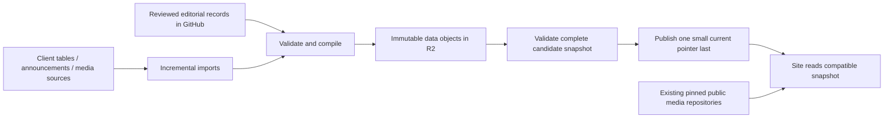

# Arkpedia system simplification plan

Planning date: 2026-10-24. This is the target and migration backlog, not a claim that
the current deployment already works this way. Read alongside [current architecture](../architecture.md).

## Decisions agreed with the maintainer

- One application codebase on `main`, with short-lived feature branches and Cloudflare
  feature previews. No permanent `dev` or `cloudflare` mirror is needed in the end state.
- Develop and iterate locally. Publish a preview when a feature is ready to test remotely.
  Merge reviewed, verified features into main to release. "Dev" means an environment,
  not another permanent integration branch.
- Keep Vercel serving www until Cloudflare production is verified. Switch the public
  domain only after the migration acceptance checks and rollback rehearsal pass.
- Routine validated data updates publish automatically; risky changes get a preview.
- Review unreleased dev features individually. Do not promote all of dev just to
  consolidate infrastructure. Review the framework/adapter upgrade as a distinct change.
- Preserve the old simulator and its branches in an archived
  `arkpedia-stage-simulator-legacy`, then rename the standalone project to
  `arkpedia-stage-simulator`. No repository deletion is needed.

## Findings and constraints

- Main and dev differ in 254 files; dev and cloudflare differ in another 47 files
  at the initial audit. "Zero behind" describes ancestry, not equal code.
- One measured successful Check took about 27m35s. Its browser suite took 18m02s,
  application/Python tests 1m58s, and the two Next builds together 2m27s. This is one
  sample, not a p50 benchmark. [Run evidence](https://github.com/arkpedia/arkpedia/actions/runs/40079637318).
- Current Check already reuses successful exact-tree evidence after merges and has
  browser-impact detection. Extend those mechanisms rather than adding a competing planner.
- The old simulator has multiple feature branches. One sampled branch,
  `feat/tragodia-public`, is one commit ahead and 265 behind master. Archive only after
  recording every branch and unique commit, including work not present in the standalone.
- `cloudflare` and `cloudflare/dev` cannot coexist as Git branch refs. Feature branches
  remove the need for either name.
- Current R2 is OpenNext's generated-page cache, not canonical game data storage.
- The existing app content pipeline aggregates multiple sources already. The main
  simplification opportunity is delivery, compatibility and publication orchestration.
- Provider dashboards, actual billing, storage volume and traffic have not been audited
  in this planning pass. No cost saving or preview compatibility is assumed verified.

## Target release path

Use one build owner for Cloudflare: prefer the existing self-hosted CI build/deploy
path if the preview proof supports it; otherwise use Workers Builds for that build
and do not also build the same target in Actions. Compare measured cost and queue time
before choosing. Local iteration must not trigger remote builds by itself.

A preview is a real isolated environment, not merely an uploaded production Worker
version URL. Promotion must identify the tested app commit, build configuration and
content contract. Reuse a build artifact only if environment-specific inlining and
bindings allow it; never label a separately rebuilt bundle as the exact tested artifact.

## CI target: less repeated work, relevant gates

| Change / moment | Default work |
| --- | --- |
| Local iteration | Relevant unit tests and changed-area checks; normal dev server |
| Docs only | Documentation links/syntax; no app build or remote preview |
| Importer/data tooling | Importer/contract tests and relevant validation; no all-page browser crawl |
| Ordinary UI feature ready for preview | Typecheck/lint, relevant units, one target build, affected desktop/mobile journeys |
| Shared navigation, tokens, layout or storage | Broader journey coverage, themes and viewport checks |
| Content schema/runtime adapter/dependencies | Full compatibility and rollback checks plus production-like build |
| Main release | Reuse exact-tree proof where valid; deploy gate and short deployed smoke suite |
| Full regression | Manual and release-candidate runs; decide later whether a scheduled run adds value |

Keep a compact core suite: homepage navigation, schedule upcoming/past and Back,
story list/map navigation, operator detail, base planner and mocked account import.
Feature suites cover their own behavior. Real account imports are a separate human
acceptance check using the maintainer's account, never CI credentials.

Move exhaustive external-media verification to asset/data publication, with affected
media checks on app changes. Eliminate duplicate browser assertions and redundant
page visits after identifying what each test protects. Keep useful mechanics,
provenance, privacy, schema, publication-integrity and rollback tests.

Unknown file impact falls back to broader checks. Show selected/skipped suites and
why. Do not make a fast lane green by skipping a failed gate or widening tolerances.
Initial engineering target: ordinary ready-for-preview feedback below 8 minutes on
current hardware; report baseline and p50/p95 before treating this as a promise.

## Data and assets: recommended pilot

GitHub retains reviewed source, provenance, import tooling and history. R2 initially
holds generated delivery data only, separate from the existing ISR cache. Media stays
where it is during the pilot. Migrate a media family only after measuring bytes,
object counts, read/write traffic, cache hit rates and rollback/storage costs.

Keep versioning automatic and mostly invisible: one snapshot identity, a manifest,
and immutable objects with asset references. Upload and verify every required object
before moving the small environment pointer. Readers pin one snapshot per page/session.
Serialize publishers and reject stale updates; R2 is not a multi-object transaction.
Retain a tested previous snapshot and publish rollback by moving the pointer back.

Prefer reuse of unchanged objects to copying the entire asset/data corpus per release.
Use a readable release report and one publish/rollback command; maintainers should not
manually coordinate Git SHAs, multiple branches and deployment fingerprints.

Start with an R2 mirror of the existing schema/payload shape to separate delivery
migration from a data-model rewrite. Later, evaluate compiling normalized game records
into page props in the app instead of publishing app-specific props. Keep that change
only if measured bundle size, render CPU and compatibility are acceptable. Replacing
every payload with one giant JSON download is not the target.

Routine previews read the current production snapshot without write access. A risky
import/schema change uses its own candidate snapshot; it must not update production's
pointer. Preview page caches, revalidation queues and any writable resources are isolated.
Keep original/upstream provenance and explicit editorial overrides so later imports do
not erase corrections. A missing input preserves the previous good record and reports
the missing piece rather than silently overwriting it.

Risky changes include schema migrations, bulk removals, identity/ID remapping, changed
source precedence and unusually large diffs. Preview the proposed additions/changes/
removals and checks. Routine updates with stable schema and expected diffs publish
automatically after validation. Thresholds will be based on actual dataset changes.

Keep GitHub delivery as a measured, explicit fallback during the pilot. Do not leave
two independently writable sources of truth. Garbage collection must preserve every
snapshot referenced by a retained deployment, preview or rollback; retention and
object reachability must be specified before deletion is enabled.

R2 Standard currently includes 10 GB-month storage, 1M Class A and 10M Class B
operations monthly, with no egress charge. It is not unlimited free storage. Use a
custom domain for cached public production delivery, not the rate-limited r2.dev
endpoint. A private Worker binding is appropriate for server-only reads.
[Pricing](https://developers.cloudflare.com/r2/pricing/),
[public delivery](https://developers.cloudflare.com/r2/buckets/public-buckets/).

## Ordered milestones and acceptance

### 0. Preserve and measure

- [x] Record agreed branch/data/simulator direction and initial CI timing evidence.
- [ ] Inventory unreleased features, provider bindings, deploy hooks, current cron jobs,
  content consumers, legacy repository branches and incoming links.
- [ ] Record traffic, CPU, build minutes, object counts/storage and current spend.
- [ ] Record app/content rollback targets and branch/tag backups. Treat PR #738 as
  pending work: retain its checklist/architecture, adapt its report to the new targets.

### 1. Prove the Cloudflare development loop

- [x] Test one harmless feature preview using the actual OpenNext adapter and pinned
  Wrangler, including static files, ISR, revalidation and release refresh.
- [x] Verify WORKER_SELF_REFERENCE never calls production from the preview. Current
  Worker Previews service bindings can target production rather than a matching
  preview. Same-Worker calls may require ctx.exports or a dedicated staging Worker.
- [x] Verify separate writable R2/cache resources and Durable Object namespaces;
  sharing an R2 bucket name shares its objects even between Previews.
- [x] Test account-relay origin rules and network metadata on the selected preview
  hostname. Permit only the intended preview hosts; no broad workers.dev allowlist.
- [x] Do not create a relay container per ordinary UI preview. Reuse the permitted
  non-production relay path unless relay behavior itself is under test.
- [x] Choose native Worker Previews only if these checks pass. Fallback: a separate
  staging Worker/environment deployed from feature branches, still with one main codebase.
- [ ] Demonstrate preview creation, update and cleanup without production writes.

[Preview behavior](https://developers.cloudflare.com/workers/previews/),
[resource/service isolation limitations](https://developers.cloudflare.com/workers/previews/resources/),
[OpenNext local preview](https://developers.cloudflare.com/workers/framework-guides/web-apps/opennext/).
OpenNext's existing `cf:preview` command runs locally; it is not the remote branch-preview workflow.

### 2. Make CI proportional

The [first proof results](system-simplification-progress.md) record the isolated
staging decision, measured timings and remaining acceptance coverage.

- [ ] Inventory time and protected behavior per suite; eliminate overlapping page crawls.
- [ ] Implement fast/relevant, broad/shared and release-compatibility lanes with a
  conservative fallback. Keep existing exact-tree reuse and resource limits.
- [ ] Remove unnecessary duplicate builds where one artifact can prove both claims;
  keep old-release compatibility tests when schema/runtime behavior changes.
- [ ] Validate reduced suites against representative past regressions. Measure feedback
  on several real PRs before retiring the old all-purpose Check path.

### 3. Consolidate code and branches

- [ ] Review Cloudflare hosting adaptations and framework upgrades independently of
  unreleased product features. Keep Vercel compatibility while both hosts are active.
- [x] Preserve deferred dev features on named branches/PRs or a durable backup tag.
  Annotated `migration-preserved/2026-10-24/dev` retains `994952e7`; companion main/
  Cloudflare tags and a verified complete-history bundle preserve the migration baseline.
  Preservation is complete; individual feature review and promotion are still pending.
- [ ] Make main deploy to Vercel and the CF production-candidate hostname from the same
  reviewed code. Review parity and provider-specific behavior explicitly.
- [ ] Switch feature PRs/previews to main. Stop Vercel dev deploys and obsolete dev
  content compiles only once all consumers are moved or accounted for.
- [ ] Retire main-to-dev/cloudflare synchronization and its alerts after dependants
  change. Archive branch tips before deleting obsolete refs; update AGENTS/README,
  workflows, content-channel selection and the release report together.

### 4. Pilot data delivery on R2

- [ ] Mirror one complete compatible snapshot; inventory sizes and upload only changes.
- [ ] Prove checksums, missing-object handling, concurrent publication, pointer promotion,
  cache refresh and one-command rollback in staging.
- [ ] Compare latency, CPU and estimated monthly operations/cost against GitHub delivery.
- [ ] Promote the pilot only if it improves simplicity/reliability within the agreed
  budget. Retire duplicate pointer branches/compiled channels only after consumers move.
- [ ] Decide media migration family by family. No bulk copy or source-repository deletion.

### 5. Cut production over, then retire Vercel

- [ ] Verify representative routes, redirects, canonical/SEO, image variants, voices,
  music, animated art, account import, planners, browser Back and mobile/light/dark UI.
- [ ] Verify content-only updates, new pages, deploy cache invalidation, old tabs,
  schema compatibility, failures and rollback. Compare cold and warm requests.
- [ ] Check DNS, apex/www behavior, certificates, security headers, preview noindex,
  analytics and account-relay origins. Keep browser storage on the existing canonical
  www origin; alternate-host storage does not transfer automatically.
- [ ] Run a measured multi-day soak that includes app deployment and data publication.
  Cutover readiness is based on evidence and cost, not a successful homepage alone.
- [ ] Move arkpedia.net/www to CF with Vercel still available for rollback. Recheck the
  actual public domain. Disable Vercel deploys only after the rollback window is agreed
  and the public-domain checks pass; remove provider resources last.

### 6. Simplify simulator naming and close out

- [ ] Capture every legacy branch/tag and unique work; inspect consumers, releases,
  submodules, workflows, remotes and hard-coded raw/CDN URLs in all related repos.
- [ ] Rename old repo to legacy, archive it, rename standalone to the desired name.
  Keep licences, attribution, issue/release history and branch access intact.
- [ ] Update and verify references. Reusing the old repository name means old URLs
  may resolve to the new project rather than redirect to the archived one; do not
  rely on implicit redirects for old raw paths or immutable commit references.
- [ ] Replace the current architecture diagrams, delete obsolete documentation and
  scripts only after migration, and produce a final cost/latency/CI comparison.

## Boundaries and remaining choices

### Initial cost estimate

Measured the production release manifest on 2026-10-24: 8,963 unique generated
delivery objects totalling 258,553,041 bytes (about 259 MB), including 838 page
records. This excludes the image/voice/animation corpus, source records, current
OpenNext cache and request overhead. Thirty fully separate snapshots of this size
would use about 7.76 GB before those other objects; deduplication should reduce it,
but existing R2 usage consumes the same account allowances. One full daily upload
would write roughly 269,000 objects over 30 days; avoid repeating it per preview.

Initial planning allowance for additional preview/data-pilot usage: roughly USD
0–5/month if Workers Paid is already enabled, preview traffic is low, existing
allowances have headroom and relay containers are not duplicated. This is a
conditional estimate, not a verified billing forecast or spend cap. Workers Paid's
USD 5/month minimum would be additional if it is not already active. App CPU,
requests, Durable Objects, logs, build overages and relay-container activity still
need measurement. No separate container per UI preview is planned.

R2 and Workers/build pricing were checked against official documentation. Workers
Builds Paid includes 6,000 build minutes/month with USD 0.005/minute overage; using
existing self-hosted builds instead avoids that build-meter charge but still uses
NAS electricity, hardware and queue capacity. Removing Vercel only saves cash if
its current bill includes avoidable charges. Do not claim a net saving before
reading the current invoices and usage.

References: [Workers pricing](https://developers.cloudflare.com/workers/platform/pricing/),
[build pricing](https://developers.cloudflare.com/workers/ci-cd/builds/limits-and-pricing/),
[container pricing](https://developers.cloudflare.com/containers/platform/pricing/).

No DNS cutover, repository rename/archive, branch deletion, provider preview-model
switch, new billing commitment or R2 production publication has happened in planning.
These steps follow their evidence gates. The maintainer approved the legacy archive/
rename direction; execute it after the dependency/branch inventory, not as deletion.

Final choices still need the preview proof and measurements: native Previews versus
a staging Worker, CI build ownership, production content compatibility policy, R2
retention, cost budget and Vercel rollback window. Do not solve uncertainty by adding
another permanent branch, database, queue or service by default.
